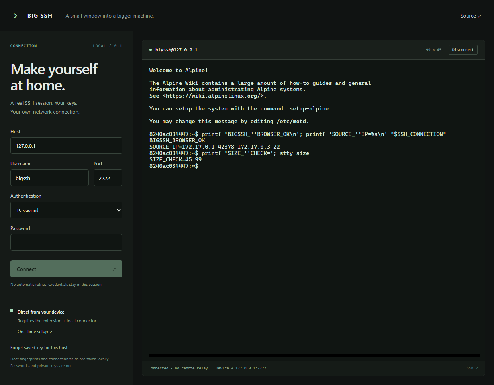

# The Big SSH in the Big Browser

An open-source browser SSH terminal with a long-term goal: **direct SSH, zero relays, in an ordinary browser tab across browsers.**

Users should be able to choose their own compatibility transports, including relays and Isolated Web Apps (IWAs), and configure their workspace with a JavaScript setup kit.

The primary implementation path is now an ordinary browser tab plus an extension and a small local TCP connector. It connects from the user's device to unchanged SSH servers. An explicit relay mode will support users who prefer to connect without installing the connector, when a relay endpoint is available. See the [local connector design](docs/LOCAL-CONNECTOR.md).

## Status

**Working development prototype:** an ordinary browser tab runs SSH in a WebAssembly worker and reaches a real, unchanged OpenSSH server through an extension and local TCP connector. There is no remote session relay.

Verified on Windows with Playwright Chromium 156 and a local OpenSSH 10.2 container: password and imported Ed25519 authentication, terminal input/output, PTY resize, disconnect, first-use host-key rejection, changed-key blocking, origin/destination authorization, and source-address comparison with a native TCP baseline. This is a development build, not a production release or an all-browser compatibility claim. [Setup and verification](docs/DEVELOPMENT.md).



Ordinary browser tabs currently lack arbitrary TCP access to unchanged SSH servers. Running an SSH engine in WebAssembly does not remove that network restriction. Direct, relay-free operation in every browser remains an unresolved research objective. Optional transports will be labeled by their actual requirements and will not count as completion of that objective.

See the [engineering plan](docs/PLAN.md) for evidence, architecture, experiments, and milestone acceptance criteria.

## What works

- xterm.js terminal, saved connection fields and host fingerprints, session-only credentials, key import and Ed25519 generation.
- Go `x/crypto/ssh` compiled to WASM. SSH negotiation, authentication, and host-key verification run in the browser worker.
- Manifest V3 extension with exact-origin pairing and explicit host/port grants; a small Go native-messaging host supplies one bounded TCP byte stream per process.
- Trusted build-time [workspace configuration](apps/web/workspace.js) for the default destination, terminal settings, and startup behavior.

Firefox/Safari/mobile transport support, optional relay/IWA adapters, broader SSH/authentication coverage, and the isolated JavaScript recipe kit are still planned. The current workspace module is trusted application code, **not a sandbox for untrusted scripts**. The OpenSSH/WASM engine comparison remains open.

## Run the development build

Install Node.js 24 and Go 1.26.5, then:

```powershell
npm ci
npm run build
powershell -NoProfile -ExecutionPolicy Bypass -File tools/install-connector.ps1 -Browser Chrome
npm run preview
```

In `chrome://extensions`, enable Developer mode and load `dist/extension` unpacked. Open `http://127.0.0.1:4173`, enter a destination, and approve its exact host/port in the extension settings when prompted. See [DEVELOPMENT.md](docs/DEVELOPMENT.md) for Edge/Chromium, removal, testing, and limitations.

**Railway/dev.new: 0 of 1 live tests used.** Do not use a live sandbox while developing; use the loopback fixture. No automatic retries. [Testing policy](docs/TESTING.md).

## Start here

- [Engineering plan and roadmap](docs/PLAN.md)
- [Transport research and experiment backlog](docs/TRANSPORT-RESEARCH.md)
- [Local connector architecture and first-run modes](docs/LOCAL-CONNECTOR.md)
- [Testing strategy and one-attempt Railway limit](docs/TESTING.md)
- [Run the experimental ordinary-tab networking lab](experiments/direct-tab/README.md) — 23 probes with passive packet capture; [Chromium/Firefox results](docs/results/direct-tab-lab.md)
- [32-option transport catalog with primary sources](docs/transport-options.json)
- [Proposed startup API](docs/startup-api.example.mjs) — design sketch, not an implemented SDK
- [Contributing](CONTRIBUTING.md)
- [Security reporting](SECURITY.md)

## Design commitments

- SSH negotiation and host-key verification belong in the browser client.
- The connection UI must disclose relay and installation requirements.
- Direct mode must fail clearly when unavailable; it must never silently select a relay.
- Compatibility claims require reproducible tests against real SSH servers.
- Configuration exports exclude credentials by default.

## License

[MIT](LICENSE). Dependencies retain their own licenses; see [third-party notices](THIRD_PARTY_NOTICES.md). The build copies runtime licenses into `dist/licenses`.
