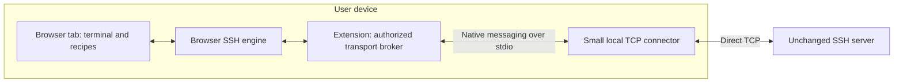

# Local connector: primary implementation path

Decision date: 2026-10-15. The user accepts an ordinary browser tab plus an extension and a small local connector. Local operation is the preferred path; an optional relay mode should serve people who want to connect without installing the connector. The first Windows/Chromium local implementation now passes real OpenSSH fixture tests; relay mode remains planned. [Setup and measured coverage](DEVELOPMENT.md).

## Two connection modes

**Local connection:** install the extension and connector once, then use the browser terminal. The connector opens a normal TCP socket from the user's device to the unchanged SSH endpoint. No remote relay or target-side installation is required. It is a local byte bridge, which differs from the original helper-free research goal.

**Relay connection:** select a configured relay endpoint to connect without a local installation. An available relay is still required; opening the static web app alone does not provide TCP access. Initially support user-supplied or deployment-configured endpoints. Running a project-operated public relay is a separate hosting and operations decision, not authorized or provisioned by this design.

Both modes keep the SSH engine and host-key verification in the browser. Profiles and startup recipes share the same API. Changing modes must not silently change the target, credentials, or host-key trust.

## Identity and source address

SSH login identity comes from the username and authentication exchange. In either mode, the user can authenticate with their own key or password. [SSH authentication protocol](https://www.rfc-editor.org/rfc/rfc4252.html)

With a local connector, the target sees the network egress address used by the device's TCP connection. That is usually the user's public NAT address, or a configured VPN/network gateway's address. Browser proxies, split tunneling, address-family selection, and policy routing can make browser HTTPS and native TCP use different egress addresses; do not promise they are always identical.

With a remote relay, the target normally sees the relay's source address. Sending a client-IP field does not change the TCP peer. PROXY protocol requires a compatible receiver; transparent proxying requires controlled return routing. Neither is a general workaround for unchanged third-party SSH endpoints. [PROXY protocol](https://www.haproxy.com/documentation/haproxy-configuration-tutorials/proxying-essentials/client-ip-preservation/enable-proxy-protocol/), [transparent routing](https://www.haproxy.com/documentation/haproxy-configuration-tutorials/proxying-essentials/client-ip-preservation/transparent-proxying/)

For services binding access or preview links to a source IP, this difference is functional, not merely a log detail. Railway's unclaimed VM previews are one documented example. [Railway free VMs](https://railway.com/free-vm)

## Preferred local architecture

Chrome and Firefox document native messaging between extensions and registered local applications. Registration and installation differ by browser and OS. This design needs both pieces; a normal extension alone does not provide a portable raw-TCP API. Start with desktop Chrome/Chromium and Firefox feasibility, then explicitly validate other browsers and OSes. Safari and mobile support remain separate investigations. [Chrome native messaging](https://developer.chrome.com/docs/extensions/develop/concepts/native-messaging), [Firefox native messaging](https://developer.mozilla.org/en-US/docs/Mozilla/Add-ons/WebExtensions/Native_messaging)

Prefer an on-demand native messaging host communicating over stdio rather than an unauthenticated localhost HTTP/WebSocket listener. The host opens approved TCP sockets and forwards bytes. It does not launch a shell, invoke a system SSH client, handle private keys, terminate SSH, or call a project backend.

The extension validates the requesting page origin, binds sessions to that origin/tab, and checks user-approved host/port grants before calling the host. The native-host manifest allows only the intended extension IDs. Self-hosted web-app origins need explicit pairing, not a wildcard permission for every website.

Use a versioned protocol with session creation, data, close, errors, and flow-control acknowledgements. Native messaging is JSON framed; encode byte chunks within the documented message limits and bound queues in both directions. Avoid one native message per keystroke and preserve input responsiveness when another session produces heavy output. Session teardown must close its sockets; host loss must produce a visible disconnect. Do not transparently switch to a relay after failure.

Keep diagnostics to endpoint identifiers, state transitions, and byte counts by default. Do not log terminal contents or authentication material. The local connector should need ordinary user privileges; no packet capture, driver, or system-wide network interception belongs in the runtime path.

## First-run experience

- Offer **Local connection** as the recommended option, with one-time installation and connection status.
- Offer **Relay connection** as an explicit alternative when a relay endpoint is available. State that it uses the relay's source IP; credentials for the relay and SSH server are distinct.
- After installation, detect the extension and perform a connector protocol handshake; report missing, unsupported-version, and disconnected states separately.
- Ask for the destination and credentials through the normal connection profile. The target requires no setup command.
- Save the user's chosen transport with the profile. Startup connections use that choice and its existing grants.

A no-install demo may use an explicitly configured relay or a local simulated terminal. A simulated terminal must be labeled as such and is not evidence of SSH compatibility. Do not label relay mode as preserving the user's source IP.

## First implementation milestone

Build a minimal extension/native-host transport spike against a controlled, unchanged SSH server. Confirm browser-to-host messaging, exact byte delivery, cancellation, target authorization, IPv4/IPv6 and DNS behavior, and bounded buffering. Connect the selected browser SSH engine and demonstrate host-key rejection and a real login.

Verify that the target's observed source address matches a native direct connection from the same machine under the same network configuration. Separately test whether browser HTTPS uses the same egress. Use controlled fixtures first; do not create a Railway/dev.new environment without a separate request.

Railway has a project-wide budget of **one live end-to-end test total**, with no automatic retry. All development and browser-matrix testing uses local fixtures. Follow [TESTING.md](TESTING.md), including reserving the attempt before connecting and treating uncertain outcomes as consumed.

The milestone succeeds when the ordinary-tab UI reaches unchanged SSH through the explicitly installed local connector, with no remote session relay and no server modifications. Record browser/OS versions and distribution/setup requirements. Helper-free ordinary-tab SSH remains a separate long-term platform research goal.
