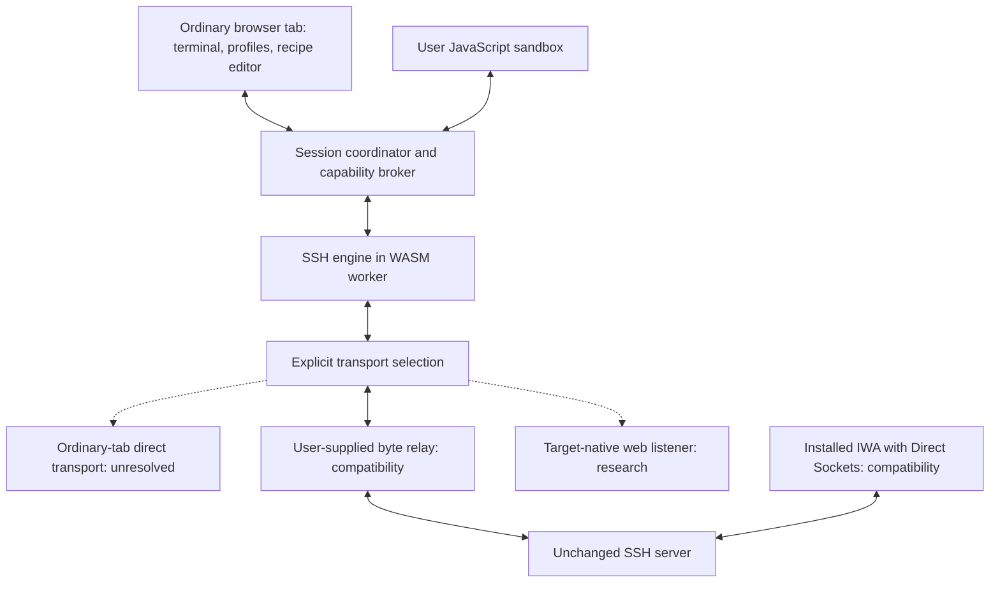

# The Big SSH in the Big Browser: engineering plan

Planning status: 2026-10-15. No SSH client or direct-connection proof has been implemented yet.

For the expanded transport survey, engine choices, and ordered experiment backlog, read [TRANSPORT-RESEARCH.md](TRANSPORT-RESEARCH.md) and the [32-option catalog](transport-options.json). The expanded roadmap prioritizes capability measurement, engine comparison, and a target-native WSS prototype before optional compatibility adapters.

## Product contract

Build an open-source SSH terminal whose main interface runs in an ordinary browser tab. Users can choose their own compatibility transports, including relays or an installed Isolated Web App (IWA). These are optional modes, not completion of the ultimate goal.

**Ultimate acceptance test:** an ordinary, unmodified browser tab connects to an unchanged, directly reachable SSH server, with no relay, native helper, installed privileged app, extension, special browser flags, or server-side protocol bridge. Repeat across the supported browser engines. The aspirational target is all browsers; a published versioned test matrix must define what has actually passed.

There is currently no demonstrated implementation path meeting all those conditions. The missing primitive is arbitrary bidirectional TCP access from an ordinary tab. Implementing SSH in JavaScript or WebAssembly does not provide that access. Treat this as a platform research problem, not a promised feature waiting for routine coding.

## What the evidence establishes

- The ordinary web exposes constrained network protocols rather than arbitrary TCP. WebSockets explicitly do not expose raw network access; their handshake and framing require a matching endpoint. Changing the port cannot turn that endpoint into a standard SSH server. [WebSockets standard](https://websockets.spec.whatwg.org/)
- Fetch forbids methods including CONNECT; it is not a browser-accessible arbitrary TCP tunnel. Changing CORS headers does not change the wire protocol. [Fetch standard](https://fetch.spec.whatwg.org/#methods)
- WebRTC data channels and WebTransport require their own peer protocols. An unchanged SSH daemon is not such a peer. They are adapter candidates when the user supplies a compatible endpoint, not evidence of direct SSH compatibility. [WebRTC specification](https://www.w3.org/TR/webrtc/), [WebTransport specification](https://www.w3.org/TR/webtransport/)
- Direct Sockets offers actual TCP in an IWA. Its scope excludes ordinary tabs. Chrome's introduction documents restricted production availability, with development installation separately documented. Validate OS, browser version, flags, and permissions before claiming support. [Direct Sockets](https://developer.chrome.com/docs/iwa/direct-sockets), [IWA introduction](https://developer.chrome.com/docs/iwa/introduction), [development setup](https://chromeos.dev/en/tutorials/getting-started-with-isolated-web-apps/1)
- Chromium libapps contains an OpenSSH WASM/WASI port and the WASSH JavaScript socket integration. Its socket documentation includes Direct Sockets and relay paths. Reuse requires auditing and removing implicit relay behavior from direct mode. [OpenSSH port](https://chromium.googlesource.com/apps/libapps/+/HEAD/ssh_client/README.md), [WASSH sockets](https://chromium.googlesource.com/apps/libapps/+/HEAD/wassh/docs/sockets.md)

These establish a current platform boundary, not a proof about every future browser or an invitation to depend on browser vulnerabilities.

## Architecture: portable client, explicit transports



The IWA reuses the client packages in its own privileged runtime. Moving tab traffic through an IWA would create a local bridge and must be labeled compatibility mode. It does not give an ordinary tab direct TCP access.

### Client components

1. **Terminal UI:** evaluate xterm.js for rendering, keyboard input, resize, Unicode, selection, accessibility, and browser-specific behavior. Keep its renderer replaceable. Bundle assets locally. Treat terminal output, titles, links, and escape-sequence payloads as untrusted. [xterm.js security guidance](https://xtermjs.org/docs/guides/security/)
2. **SSH engine:** evaluate the existing OpenSSH WASM port first. Pin upstream revisions, publish the build recipe, and track the enabled algorithms and build options. Audit dependence on libapps UI, storage, workers, and syscall handlers before extracting it. Do not assume native OpenSSH feature parity.
3. **Byte transport:** asynchronous readable/writable byte streams, cancellation, bounded queues, backpressure, connection metadata, and truthful capability reporting. Preserve arbitrary chunk boundaries and partial writes. A future direct adapter should not require changes to terminal or authentication code.
4. **Session coordinator:** explicit connection state machine, host-key verification, authentication prompts, terminal channels, lifecycle events, and reconnect decisions. Each session gets its own engine state.
5. **Local state:** profile configuration, known-host records, encrypted private-key storage, and recipe configuration. Keep unlocked secrets transient; locking disposes the engine that held them. Do not claim reliable zeroization of JavaScript memory. Public configuration exports exclude secrets by default.
6. **Recipe runtime:** separate from SSH engine memory; capabilities are mediated by the coordinator. Ordinary Workers alone are not permission sandboxes. Evaluate a WASM JavaScript interpreter with no ambient I/O, explicit RPC bindings, instruction/time limits, and memory limits. Validate the chosen isolation before accepting third-party scripts.

### Transport contract

Every adapter reports at least:

- Whether it runs in an ordinary tab, needs installation, or needs special settings.
- Whether it uses a relay or local bridge and where that component is located.
- Whether the SSH server is unchanged or requires a special listener.
- Whether SSH remains end-to-end between the browser engine and target.
- Supported browser versions, tested environments, and known limitations.

Connection UI shows the selected path before authentication. Never silently fall back from direct mode to a relay. Missing support returns an actionable capability error, not a simulated successful session.

## Transport workstreams

### A. Ordinary-tab direct research

Maintain small reproducible experiments with expected wire protocols and packet captures. Inventory standards, implementations, and proposed APIs. A useful result can be a documented negative result.

To count as a successful experiment, it must reach an unchanged SSH daemon, exchange SSH identification and key-exchange bytes bidirectionally, and eventually authenticate in an ordinary tab with no additional networking process or custom target listener. A screenshot of a terminal is insufficient.

Do not promote WebSocket, WebRTC, WebTransport, service workers, WASM virtual machines, emulated TCP stacks, or a changed port as a solution without showing how the browser emits and receives the required traffic. A virtual network stack still needs a real packet transport.

### B. User-supplied relay compatibility

Support a documented binary byte-tunnel protocol over WSS first. The user supplies the endpoint and authorization. SSH negotiation and host-key checking stay inside the browser. The relay should forward encrypted SSH bytes, not terminate SSH and send a remote PTY stream.

Specify target selection, authorization, origin validation, size limits, and flow control. Avoid credentials in URLs and logs. Test the exact relay implementation rather than promising arbitrary gateway compatibility. Additional protocols can be added as adapters.

This creates a useful ordinary-tab app across tested browsers while the direct research remains unresolved. It is expressly a relay mode.

### C. IWA direct compatibility

Reuse the client in an installed IWA and connect via TCPSocket. Verify public hosts, private hosts, DNS, IPv4/IPv6, worker exposure, required permissions, cancellation, and packaging on each OS we claim. Test a signed bundle with no development asset server involved in runtime traffic.

This can demonstrate real relay-free SSH in a browser runtime, but does not pass the ordinary-tab acceptance test.

### D. Target-native web listener research

A modified SSH server could potentially terminate a browser-compatible transport itself and feed SSH into its own protocol engine. If no separate process forwards the session, this differs from a conventional gateway. It still requires target changes and cannot establish compatibility with unchanged SSH servers. Whether it fits the user's relay definition must be settled before presenting it as a zero-relay option. No such implementation is claimed here.

## JavaScript setup kit

Provide composable recipes and a data-only configuration format. Start with:

- Named host profiles and credential references.
- Startup layout, tabs, terminal settings, and selected workspace.
- Connect-on-open to explicitly chosen profiles.
- Commands after authentication and PTY readiness.
- Manual command-palette actions, key bindings, and reconnect policy.
- A local browser workspace with virtual files and per-recipe state.
- Import/export of configuration and separately controlled secret handling.

The sandbox is for browser-side automation and virtual files. It is not a claim that the browser can start arbitrary host OS processes or install a real local container.

Separate lifecycle events: app opened, profile selected, connection requested, host verified, authenticated, PTY ready, disconnected, and reconnected. App startup means opening the app; OS-login startup is a separate, platform-specific feature.

Do not infer authentication from a shell prompt. Run remote actions only after the engine confirms the relevant state. Recipes declare which profiles and actions they can access. Credentials remain behind references, with no private-key export API for scripts. A script allowed to run remote commands still has substantial authority; the recipe editor must show that scope.

Remote setup actions need a deliberate retry policy. A disconnect can leave command execution ambiguous. Do not claim exactly-once execution; do not automatically replay uncertain side effects. Allow explicit rerun or scripts designed to be idempotent. Keep shell-specific quoting and Windows/POSIX commands explicit.

For the ordinary-tab build, user-authored JavaScript runs in the separately validated recipe VM. For the IWA build, custom executable modules should be selected at build time and included in the signed package; use data-only recipe selection at runtime. IWA policy disallows dynamic code sideloading and using interpreters to run downloaded scripts with privileged networking. This is a real difference between the two distributions. [IWA developer policy](https://developer.chrome.com/docs/iwa/developer-policy)

See [startup-api.example.mjs](./startup-api.example.mjs) for a proposed authoring shape, not an implemented SDK.

## Compatibility means measured coverage

Initial target: SSH-2 servers directly reachable from the selected transport, including OpenSSH on Linux and Windows, Dropbear, and representative network-device SSH servers where test access exists.

Test password, keyboard-interactive/MFA, encrypted and unencrypted imported software keys, Ed25519, RSA with modern signatures, ECDSA where enabled, and certificate authentication. Publish which combinations actually work. Older algorithms are an explicit per-host opt-in only if supported by the chosen engine.

Test PTY sizing, Ctrl-C, Unicode, bracketed paste, vim, tmux, high-volume output, flow control, session teardown, invalid DNS, timeouts, failed authentication, host-key changes, and network interruptions. SFTP is a later subsystem milestone.

Native SSH agents, PKCS#11, FIDO/security keys, GSSAPI/Kerberos, ProxyCommand, and local process integrations require separate feasibility work. A browser client cannot inherit these capabilities merely because its SSH core came from OpenSSH. Jump hosts and forwarding also add intermediate paths and must be explicitly distinguished from the strict direct mode.

Reconnecting opens a new SSH session. Restoring scrollback does not restore the previous remote process. Durable remote sessions require a supported server-side session tool or a separate resumption design.

Browser matrix: test actual Chrome, Firefox, and Safari releases; test Edge and mobile variants independently where claimed. Engine coverage alone is not a promise of identical OS or mobile lifecycle behavior. Record versions and dates, including background suspension and page-close behavior.

## Milestones and exit criteria

1. **Capability lab:** versioned browser capability report and minimal experiments. Separate proven direct paths, compatibility paths, and unsupported paths. Record the ordinary-tab TCP blocker openly.
2. **Usable tab client:** local terminal UI, extracted WASM SSH engine, explicit BYO relay adapter, real login against test SSH servers, and browser-side host-key verification. This is an interim compatibility release, not completion of the final challenge.
3. **Relay-free reference build:** optional signed IWA, real direct SSH login, and traffic evidence. Keep it separate from ordinary-tab claims.
4. **Setup kit:** profiles, data recipes, validated JavaScript sandbox, lifecycle hooks, safe action retry behavior, configuration import/export, and command palette.
5. **Compatibility and hardening:** broaden the server/auth/browser matrix, test memory/backpressure and malicious terminal data, audit dependencies, and verify bundled offline behavior.
6. **Open-source release:** public GitHub repository, chosen project license, upstream notices, CONTRIBUTING, SECURITY, CI, release artifacts, reproducible WASM instructions, protocol docs, and clearly labeled feature support.
7. **Ultimate direct milestone:** remains open until the ordinary-tab acceptance test actually passes. If it requires a new browser API, document that dependency and pursue standards/browser implementation work rather than declaring an optional adapter equivalent.

No dates are attached before the capability lab and WASM extraction establish effort and constraints. The research track may require browser-vendor changes rather than application engineering alone.

## Proposed repository shape

```text
apps/web/                  ordinary-tab app and offline assets
apps/iwa/                  optional privileged distribution
packages/ssh-engine/       WASM build and browser bindings
packages/transports/       explicit adapters and capability metadata
packages/session/          state machine, host trust, auth, channels
packages/automation/       recipe schema, broker, sandbox interface
packages/storage/          local profiles and credential vault
packages/terminal/         rendering integration
tools/                     build, packaging, diagnostics; no hidden transport service
experiments/direct-tab/    minimal transport research and negative results
tests/interop/             SSH server/auth/browser fixtures
examples/                 setup recipes
docs/                     architecture, limitations, transport protocols
```

Repository name: `the-big-ssh-in-the-big-browser`. Project-authored code and documentation use the MIT license. Preserve each dependency's own license and notices when introducing third-party code.

Proposed eventual commands: `doctor`, `dev`, `build`, `bundle --recipe`, and `test:interop`, exposed through a documented package script or CLI. They do not exist yet. Setup tools prepare assets and configuration; any optional tool that forwards traffic must declare itself as a relay.

## First implementation decision

Start with the capability lab and a comparison of OpenSSH/WASM and Go/WASM. Use the selected engine in a target-native WSS experiment before building optional compatibility adapters. Keep the ordinary-tab app as the main product, and preserve the independently testable unchanged-server direct-mode acceptance test. See the expanded research roadmap for dependencies and stopping rules.
