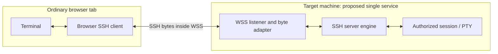

# Transport research and implementation roadmap

Research date: 2026-10-15. This extends [PLAN.md](PLAN.md). The full [32-option catalog](transport-options.json) records the candidate mechanisms, limitations, source links, and next experiments.

Evidence is documentary research, existing project documentation, and design inference. No transport experiment or cross-browser SSH login has been run for this project. Candidate does not mean implemented or validated. This survey covers the relevant architectural families and many variants, not every possible future invention.

**Live test limit:** one Railway/dev.new end-to-end attempt total for this project, with no automatic retries. Use controlled local SSH fixtures for development and browser matrices; see [TESTING.md](TESTING.md). No live attempt has been used by this project.

## Recommendation

The user now accepts an extension plus a small local connector. Make that the primary practical implementation: ordinary-tab terminal and SSH engine, with approved TCP sockets opened from the user's device. This supports unchanged third-party endpoints without a remote relay. Provide an explicit optional relay path for no-install users when an endpoint is available. See [LOCAL-CONNECTOR.md](LOCAL-CONNECTOR.md) for the accepted architecture and source-IP behavior.

The helper-free ordinary-tab goal remains separate platform research. Target-native WSS cannot connect to unchanged servers and stays parked. IWA remains an optional installed runtime. Do not make a project-hosted relay a prerequisite for the local mode, and do not silently switch modes or claim a remote relay preserves the user's source IP.

## Concrete use case: existing temporary sandbox entry points

The user wants to open a tab and connect to an existing SSH service such as `railway.new` or `dev.new`, potentially to create or enter a temporary environment. The SSH connection may be the entry point that creates the environment, so requiring a setup command inside that environment first is circular.

Railway documents `ssh railway.new` as an existing entry point. Its SSH CLI documentation also describes using the system SSH client for standard SSH connections; a Railway employee describes `ssh dev.new` as a VM preview entry point. These are concrete unchanged-target examples, not permission to provision a sandbox during research. [Railway entry point](https://railway.com/free-vm), [Railway SSH CLI](https://docs.railway.com/cli/ssh), [dev.new preview](https://station.railway.com/feedback/express-v-ms-fast-cloneable-virtual-mac-bade29ad)

For the strict mode, accept the host, port, user, and credentials with no target-side installation, port publishing, provider cooperation, local helper, or hosted relay. Merely observing a provider's own browser terminal does not establish that its transport is public, carries SSH bytes, accepts our origin/authentication model, or works with the anonymous SSH entry point. Any pre-existing provider web API must be separately documented and tested; it would be a provider-specific compatibility path, not general raw-TCP access or proof of zero forwarding.

## Define what each result actually proves

Use four independent questions for every connection path:

1. Does the user run an ordinary, unmodified browser tab?
2. Does the target run an unchanged SSH-2 server?
3. Is there any application component forwarding session traffic between the browser and target SSH engine?
4. Which actual browser/OS versions have passed the same test?

The strict finish line requires yes, yes, no, and a verified supported-browser matrix. No reviewed API currently supplies that combination. The browser's missing raw TCP capability remains the blocker. [WebSockets API](https://websockets.spec.whatwg.org/), [Direct Sockets exposure](https://wicg.github.io/direct-sockets/)

For this plan, an application relay includes local companions, same-host socket bridges, pipes into a separate SSH daemon, TURN, cloud gateways, and encrypted packet tunnels. Encryption does not make forwarding disappear. Ordinary IP routing is a distinct network layer; every remote connection still requires a reachable route. A non-routable target behind a restrictive network cannot be promised universal direct connectivity.

Separate session traffic from setup/control dependencies. Static asset hosting, certificate issuance, DNS, WebRTC signaling, and STUN can be outside the SSH data path. That does not mean they are dependency-free. Record them explicitly, and test a mode without external signaling/STUN where possible. TURN is a data relay. [STUN](https://www.rfc-editor.org/rfc/rfc8489.html), [TURN](https://www.rfc-editor.org/rfc/rfc8656.html)

## The transport families

### Native network access from an ordinary tab: T01, T02, T25-T27, T31

An interoperable, permissioned browser TCP API would address the unchanged-server requirement. The reviewed Direct Sockets API is exposed to isolated contexts, not normal sites. A prototype browser patch could explore a future permission model, but would not establish stock-browser compatibility. [Direct Sockets](https://wicg.github.io/direct-sockets/)

WebSocket APIs require the peer to understand WebSocket negotiation and frames. Stock SSH speaks a different wire protocol. Port 443, TLS wrapping, a stream-shaped wrapper, or a different URL does not reconcile them. [WebSocket wire protocol](https://www.rfc-editor.org/rfc/rfc6455.html), [SSH transport](https://www.rfc-editor.org/rfc/rfc4253.html)

Fetch forbids CONNECT and can return opaque responses that scripts cannot read. HTTP/2 and HTTP/3 implementation details do not expose arbitrary streams to JavaScript. A MASQUE/CONNECT server that does the dialing would be a proxy. [Fetch standard](https://fetch.spec.whatwg.org/)

ICE-TCP still belongs to WebRTC's ICE/DTLS/SCTP stack. A browser cannot use it as a plain SSH socket. Likewise, an ordinary tab has no general inbound TCP listener for a reverse SSH connection. [WebRTC](https://www.w3.org/TR/webrtc/)

These are short negative controls and platform-research topics, not reasons to spend weeks implementing cryptography against an unreachable endpoint.

### Target-native web transports: T03-T06

**WSS is a candidate only when target changes are explicitly allowed.** An optional experiment could use a target service that accepts a browser WebSocket, converts binary message contents into a continuous ordered byte stream, and passes that stream directly to its own SSH server engine. It must not open port 22, spawn a forwarding command, or connect to another SSH endpoint. This cannot be required to reach a third-party service such as railway.new.

This is a design inference supported by composable existing APIs: Go's SSH server accepts an underlying `net.Conn`, and coder/websocket exposes a WebSocket-to-`net.Conn` adapter. Their combination is a credible prototype path, not an already tested implementation. [SSH server transport API](https://pkg.go.dev/golang.org/x/crypto/ssh#NewServerConn), [WebSocket adapter](https://pkg.go.dev/github.com/coder/websocket#NetConn)

The server engine is the SSH endpoint. The PTY is the authorized session resource, not a socket tunnel to another daemon. Whether this target change is an acceptable zero-relay product variant remains a product decision. It does not fulfill unchanged-OpenSSH-server support.

A small fixture is tractable; a production replacement for OpenSSH is a much larger undertaking. Account authorization, privilege separation, authorized_keys options, PAM, audit trails, subsystem policies, and Windows identities do not appear automatically because an SSH library accepts a connection. First use a restricted synthetic account in a controlled test environment. Do not replace production sshd during the experiment.

**WebTransport** could supply additional reliable streams to a matching target. First confirm the browser can express the exact required protocol and establish TLS trust; arbitrary QUIC and arbitrary HTTP/3 CONNECT are not browser APIs. [WebTransport](https://www.w3.org/TR/webtransport/)

**WebRTC** could carry an ordered reliable data channel directly to a target peer. Use manual signaling in the first experiment, omit TURN configuration, and inspect the selected candidate pair. Direct success on a LAN is not evidence of success through every NAT/firewall. T05 is separate from a WebRTC-to-port-22 bridge, which is T09.

**Paired HTTP streams** could implement the same target-native concept with upload requests and a streaming response. It needs an application-level session, ordering, cancellation, and buffering design. Test actual request/response streaming behavior; do not assume full-duplex fetch support. WSS is simpler for the first interactive stream.

### Optional compatibility transports: T07-T12, T14, T21, T30

A user-supplied WSS byte tunnel is the first compatibility adapter to specify. Keep SSH authentication, host-key checks, and decryption in the browser. Use explicit endpoint selection, origin enforcement at the tunnel, per-target authorization, bounded buffering, and short-lived relay authorization. A relay login and an SSH login are separate credentials.

An existing browser client, SSH Term, already documents a Go/WASM SSH engine and a WebSocket-to-TCP proxy. It is useful engineering prior art, and explicitly a relay architecture. Study its stream integration and interoperability; do not inherit its proxy as a mandatory project service. [SSH Term](https://github.com/c2FmZQ/sshterm), [design](https://github.com/c2FmZQ/sshterm/blob/main/DESIGN.md)

Putting a wrapper on the target, moving it to localhost, using native messaging, or encapsulating a virtual network does not change the relay classification. Node/Deno server networking and cloud Worker TCP APIs are outside the browser; using them as the session path makes them a relay or remote SSH client. [Native messaging](https://developer.chrome.com/docs/extensions/develop/concepts/native-messaging), [Cloudflare TCP API](https://developers.cloudflare.com/workers/runtime-apis/tcp-sockets/), [Deno networking](https://docs.deno.com/api/deno/network/)

Offer additional adapters only when someone has a concrete compatible endpoint to test. A server-side PTY streaming protocol can be an alternate remote-terminal backend, but must not be labeled browser-side SSH.

### Installed direct runtimes: T13, T15-T17

An IWA with Direct Sockets is the clearest reference build for unchanged-server, relay-free SSH. Validate installation, permissions, worker support, DNS, private addresses, and signing on each claimed platform. Chrome documents restricted production distribution and a separate development installation path. [IWA introduction](https://developer.chrome.com/docs/iwa/introduction)

A custom browser build can prototype a capability the open web lacks. Electron/Tauri or an embedded webview can use native APIs in an installed app. These are useful fallback distributions, not ordinary-tab results. Legacy Chrome Apps and retired plugins should not become dependencies. [Electron](https://www.electronjs.org/docs/latest/tutorial/process-model), [Chrome Apps migration](https://www.chromium.org/chrome-apps/)

### Computation and packaging: T18-T20

WASM, JavaScript, a PWA, an isolated worker, and an emulated OS can implement protocol logic, persistence, and local sandbox behavior. They cannot synthesize a missing external network capability. In v86, external networking still depends on a backend; its browser-internal network has no external connectivity. [v86 networking](https://github.com/copy/v86/blob/master/docs/networking.md)

Use a virtual filesystem or small VM only if it improves the startup kit. A full Linux emulator is unnecessary for rendering a terminal and running an SSH protocol engine.

### Hardware paths: T22-T24

WebUSB could potentially control user-provided network hardware. Web Serial could supply a modem or PPP byte link. Bluetooth/HID accessories could expose custom communication channels. These are conditional hardware research ideas; inspect device class restrictions, OS driver ownership, permissions, and browser exposure before asserting feasibility. A device that opens a TCP socket on the user's behalf is a hardware bridge. A serial console by itself is not SSH. [WebUSB](https://developer.chrome.com/docs/capabilities/usb), [Web Serial](https://developer.chrome.com/docs/capabilities/serial), [Bluetooth](https://developer.chrome.com/docs/capabilities/bluetooth), [HID](https://developer.chrome.com/docs/capabilities/hid)

Park these until a user brings a specific device. They add hardware requirements and cannot establish the all-browser, no-extra-setup goal.

### Alternate protocols and fragile tricks: T28, T29, T32

SSH3/remote terminals over HTTP/3 is a different server protocol and an experimental research direction. Its use of HTTP/3 does not establish browser WebTransport compatibility. Treat it as a separate terminal backend study. [SSH3 project](https://github.com/francoismichel/ssh3)

Mosh starts through SSH and then uses its own UDP transport. It can inform later session-resilience work, but cannot bootstrap our missing browser TCP connection. [Mosh](https://mosh.org/)

DNS/covert-channel schemes require a cooperating endpoint or gateway. Parser tricks, obsolete plugins, and browser defects cannot support a portable maintained client. Record this family as excluded rather than building a product around version-specific bypasses.

## SSH engine decision: measure before committing

Run two initial candidates through the same adapter and fixture suite:

- **OpenSSH/WASM through libapps/WASSH:** existing browser port and direct-socket integration. Investigate extraction effort, custom WASI socket calls, storage integration, browser threading requirements, algorithm coverage, and upstream update cost. [Port](https://chromium.googlesource.com/apps/libapps/+/HEAD/ssh_client/README.md), [socket integration](https://chromium.googlesource.com/apps/libapps/+/HEAD/wassh/docs/sockets.md)
- **Go/WASM with x/crypto/ssh:** generic connection APIs and existing browser-client prior art. Investigate worker integration, runtime payload/startup cost, terminal event bridging, key parsing, certificates, and algorithm coverage. This may also simplify the target-native Go fixture. [SSH API](https://pkg.go.dev/golang.org/x/crypto/ssh), [browser prior art](https://github.com/c2FmZQ/sshterm)

Keep two reserve choices: libssh2/WASM has custom send/receive callbacks but needs a browser build and async integration; russh exposes generic streams but its target/runtime dependencies need a WASM feasibility check. A stream API alone is not a successful browser build. Pure-JS ssh2 targets Node.js and is not a drop-in browser library. [libssh2 callbacks](https://libssh2.org/libssh2_session_callback_set2.html), [russh stream API](https://docs.rs/russh/latest/russh/client/fn.connect_stream.html), [ssh2](https://github.com/mscdex/ssh2)

Choose on demonstrated buildability, required auth/algorithm coverage, memory under sustained output, input responsiveness, cancellation behavior, bundle/startup size, dependency licenses, and maintenance effort. Do not write a new cryptographic SSH implementation to solve a transport-access problem.

## Shared client architecture

The terminal, SSH engine, transport, local vault, and recipe interpreter have separate interfaces. The transport contract must expose cancellation and bounded byte streams, plus factual metadata: runtime requirement, target changes, relay location, browser test evidence, and SSH termination location. Feature presence alone is not a successful connection probe.

Classic WebSockets need explicit queue management. Use bounded outgoing buffers and a documented receiver flow-control mechanism for cooperating endpoints; account for engine and terminal-render queues too. Disable unnecessary WebSocket compression for the encrypted byte stream. Exercise fragmented/coalesced messages, output floods, and cancellation while a write is blocked. The terminal's renderer has its own backpressure concerns. [xterm.js flow control](https://xtermjs.org/docs/guides/flowcontrol/)

No silent fallback to a relay. Connection profiles choose a transport, and automatic selection can only choose among modes the user has authorized. Never change target identity or host-key trust as a side effect of selecting an adapter.

The hosted tab and offline build should use the same bundled assets. Some WASM runtime designs need cross-origin isolation and SharedArrayBuffer; establish deployment headers and actual browser behavior in E01. Keep an async/single-thread option if the selected engine supports it. A hosting provider that cannot set required headers may be unsuitable for that engine build.

WSS introduces browser TLS certificate validation in addition to SSH host-key trust. Establish a trusted certificate or a user-managed CA for the endpoint; do not invent a JavaScript switch to ignore browser TLS errors. Local/private targets also need testing against the browser's evolving local-network permissions, mixed-content rules, DNS, and denied-permission behavior. [Chrome local-network guidance](https://github.com/GoogleChrome/modern-web-guidance/blob/main/skills/modern-web-guidance/guides/security/local-network-access.md)

## JavaScript kit and startup behavior

Provide data-only profiles plus a typed JavaScript API for sandbox-side setup. Recipes should compose named pieces: virtual files, layout, host profiles, startup connections, terminal settings, manual actions, post-auth commands, and reconnect policy. See the existing [API sketch](startup-api.example.mjs); it is not runnable yet.

Use lifecycle states from the SSH engine: app open, sandbox ready, connect requested, host verified, authenticated, PTY ready, disconnected, reconnected, and vault locked. A delayed timer or shell-prompt regex is not an authentication signal. Distinguish an initial login from a reconnect. If a remote command's outcome is unknown after a dropped connection, require explicit rerun or an idempotent action; never promise exactly-once remote execution.

Evaluate QuickJS/WASM in its own Worker, with only brokered profile/session APIs, a virtual filesystem, execution interrupts, and memory limits. A Worker by itself still has ambient browser APIs and is not a sufficient untrusted-script permission sandbox. Validate interpreter and host-binding boundaries; do not expose raw key memory or generic signing to recipes. [QuickJS embedding](https://github.com/justjake/quickjs-emscripten)

For IWA, package custom executable hooks in the signed build and select data recipes at runtime. Do not route downloaded privileged scripts through an interpreter to evade the platform's self-contained-code policy. [IWA policy](https://developer.chrome.com/docs/iwa/developer-policy)

Proposed setup commands are `doctor`, `dev`, `build`, and `bundle --recipe`. They are not implemented. A development asset server is allowed to serve files; it must never secretly forward SSH traffic. Credential imports and connection triggers should work through a user gesture, profile ID, or command palette. Keep credentials out of deep-link URLs. OS-login startup is a separate platform integration, not the meaning of app startup.

## Authentication and interoperability scope

First test password, keyboard-interactive/MFA, imported encrypted software keys, host-key rejection, modern RSA signatures, Ed25519, and enabled ECDSA algorithms. Add OpenSSH user/host certificates and SFTP after the first interactive session. Compare against Linux/Windows OpenSSH, Dropbear, and available network-device fixtures. Do not infer coverage from the upstream engine's native feature list.

WebAuthn deserves an early focused check: SSH Term documents ecdsa-sk support through browser WebAuthn, so it is a concrete lead. Verify it against stock servers and test origin/RP binding, user presence, and credential recovery; do not generalize it to importing arbitrary existing hardware SSH keys. Authentication capability is independent of the network transport blocker. [SSH Term design](https://github.com/c2FmZQ/sshterm/blob/main/DESIGN.md), [WebAuthn](https://www.w3.org/TR/webauthn-3/)

Native agents, PKCS#11, OS Kerberos credentials, ProxyCommand processes, smart cards, and arbitrary local sockets are separate integrations. Any required companion is disclosed as compatibility mode. Forwarding and jump hosts are explicit additional paths; do not mix them into a strict no-relay claim. Reconnection creates a fresh SSH session unless a separate server-supported resumption design exists.

## Experiments, evidence, and stopping rules

### E00: Capability lab and negative controls — helper-free platform research

Create a self-contained diagnostic page and a controlled SSH fixture. Record actual browser/OS versions, context, available constructors, permissions, and failures. Test stock SSH on its usual port and an allowed alternate port to separate port blocking from protocol mismatch. Capture server-side bytes for authorized test connections. Check WebSocket, fetch, and WebRTC assumptions with minimal cases; no subnet scanning.

Deliverable: versioned result JSON, reproduction steps, and packet/log evidence. Stop a branch once its protocol mismatch is demonstrated; resume only when a concrete API or endpoint change offers a new hypothesis. Browser-specific feature flags are recorded as a different runtime, never a stock-tab pass.

### E01: Engine comparison — first, after minimal byte interface

Build OpenSSH/WASM and Go/WASM spikes against the same test transport. Demonstrate actual SSH negotiation, host-key rejection, a software-key login, keyboard-interactive prompts, PTY resize, and clean disconnect. The fixture transport can be in-memory or explicitly bridged; label it. Measure initialization and queue/memory behavior rather than estimating performance from language choice.

Deliverable: an engine decision record and a minimal reusable binding. Stop extracting a candidate if its required runtime cannot support the planned deployment or maintenance cost is clearly worse without essential compatibility benefits.

### E10: Extension and local connector — primary implementation spike

Prototype native messaging, destination grants, session-scoped byte transport, queue limits, and teardown against a controlled unchanged SSH server. Then attach a browser SSH engine and demonstrate host-key rejection and real authentication. Measure the source address the server sees against a native direct-connection baseline, including a test where browser HTTPS and native TCP have different routing policies. Record installation steps and actual browser/OS coverage. This accepted local-helper milestone does not claim helper-free browser TCP. See [LOCAL-CONNECTOR.md](LOCAL-CONNECTOR.md).

### E02: Native WSS target — optional modified-server research

Implement a restricted test server accepting binary WSS directly into an SSH engine. Negotiate SSH from a real ordinary tab and run an interactive PTY session. Instrument the server to establish that it never dials a secondary SSH socket or spawns a network-forwarding command. Use a synthetic host key and account; test wrong keys and denied authentication.

Deliverable: browser/target traffic capture, process/socket accounting, fixture source, and a repeatable login. Mark the result **modified target, ordinary tab, no forwarding intermediary**. It supplies no evidence of compatibility with railway.new or another unchanged third-party endpoint. If the only workable design forwards to sshd, reclassify it as T10 rather than counting E02 as passed. A production target daemon requires its own design and security review. Do not start this experiment as a substitute for resolving E00's unchanged-server blocker.

### E03: IWA direct reference — after E01

Connect the selected engine to Direct Sockets against unchanged SSH fixtures. Test DNS, IPv4/IPv6, local-network permissions, host trust, authentication, and teardown. Run a signed build with no development asset server required at runtime.

Deliverable: a separately labeled installed-runtime result and platform setup instructions. If the OS/browser cannot install/run the IWA, record unsupported; do not insert a local companion as a hidden fallback.

### E04: BYO WSS compatibility — after E01, explicitly optional

Specify and test one byte-tunnel protocol against unchanged servers. Preserve browser-to-target SSH cryptography and host trust. Test origin checks, relay authorization, target restrictions, half-close semantics, queue limits, and rejected connections. Verify the relay only receives encrypted SSH session contents after key exchange; pre-key-exchange metadata remains visible.

Deliverable: adapter protocol, one controlled reference fixture, and client interoperability results. It is never a strict-direct pass. Do not deploy a public forwarding service during this experiment.

### E05-E07: Additional target-native transports — after E02

- **E05 WebTransport:** prove the supported API/TLS handshake and one reliable stream into the same SSH engine. If browser exposure or deployment complexity adds no clear benefit over WSS, park it.
- **E06 WebRTC:** use an ordered reliable channel, direct candidates, and manual signaling first. Reject relayed candidate pairs in direct mode. Document network failures rather than silently enabling TURN.
- **E07 HTTP streams:** test bidirectional progress, chunk order, cancellation, and buffering in actual browsers. Park it if interactive latency or proxy buffering makes it inferior to WSS without a needed compatibility benefit.

### E08: Recipe sandbox — after one real client session

Test a valid startup recipe and adversarial recipes attempting ambient network access, private-key access, ungranted hosts, infinite loops, oversized allocations, and unauthorized remote actions. Include vault lock, page reload, auth failure, and ambiguous command outcomes. Choose the sandbox architecture only after these boundaries are demonstrated.

### E09: Browser/server release matrix — grows from E00 onward

Run desktop Chrome, Firefox, actual Safari, and Edge on supported OSes; test mobile browsers separately. Playwright WebKit is useful automation but does not replace testing shipping Safari. Record versioned passes for login, key formats, terminal behavior, SFTP, memory/queue limits, TLS/local-network permissions, suspend/resume, and teardown. Missing environments remain **not tested**.

A release can claim a compatibility mode once its checks pass. The ultimate direct milestone remains open until an ordinary unmodified tab reaches an unchanged SSH server without a bridge in the claimed browsers.

## Implementation order and project records

1. Run E10: extension/native-host transport to an unchanged SSH fixture, including source-IP behavior, user destination grants, and connection teardown.
2. Run E01 over the transport interface, choose the browser SSH engine, and demonstrate a real login through the local connector.
3. Build the terminal, profiles, startup recipes, and validated sandbox around that local path. Ship clear extension/connector detection and one-time setup instructions.
4. Add explicit no-install relay mode using a user-supplied or deployment-configured endpoint. Show relay source-IP behavior before connection; operating a public relay is a separate decision.
5. Validate desktop browser/OS coverage, then investigate other platforms, IWA, and provider-specific adapters as separate paths.
6. Keep E00 and helper-free raw-TCP platform research open. Neither the accepted local bridge nor a relayed engine test passes that stricter ultimate test.
7. Park modified-target transports unless that separate variant is wanted. No target-side listener is required for the primary local mode.

Suggested directories: `experiments/capabilities/`, `experiments/engines/`, `experiments/target-native/`, `tests/fixtures/`, and `docs/results/`. They describe future work; this documentation change does not create functioning experiments.

Every experiment record includes the hypothesis, source revision, environment, exact command/setup, endpoint changes, process/data-path diagram, observed result, evidence location, and next decision. Use synthetic/redacted captures. Keep a simple **not started / running / passed / failed / unsupported** status; never present documentary research as a passed runtime test.

No implementation duration or universal compatibility is promised before the first spikes. Initial priorities are engineering judgments based on the boundaries above, not measured scores. All code changes follow the repository's protected pull-request workflow.
